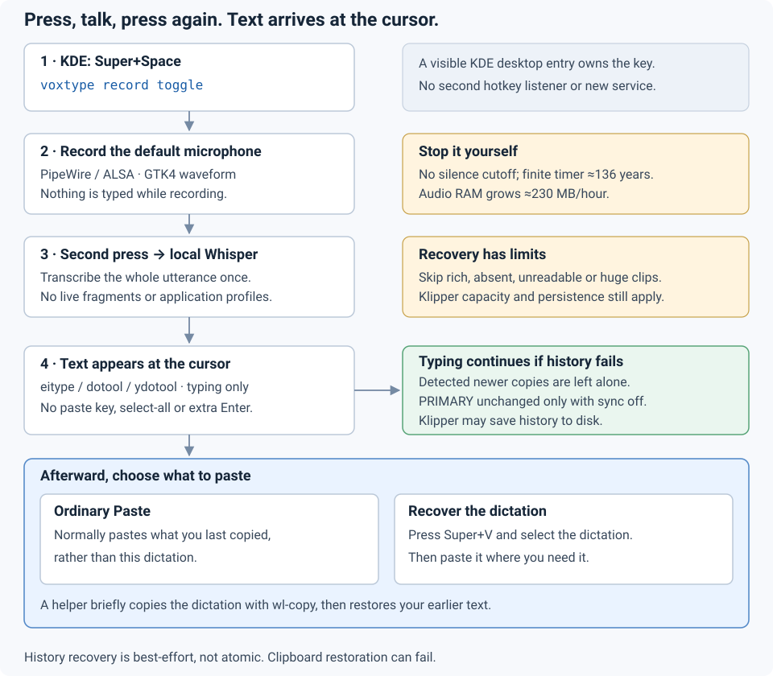

# [Voxtype](https://github.com/peteonrails/voxtype) setup for KDE

Configure **Voxtype 1.0.1 on KDE Plasma 6 / Wayland / PipeWire**: Super+Space starts and stops recording; finished text is typed at the cursor and, when supported, kept in Klipper history while your previous plain-text clipboard is restored.



This kit installs **three user-level files**, not another daemon. **Debian 13 on amd64 is the tested baseline.** The prebuilt package requires an x86-64-v3 (AVX2) CPU. Ubuntu/Kubuntu with compatible Plasma 6 packages is untested; package and service names may differ.

```sh
git clone https://github.com/dnouri/voxtype-setup.git
cd voxtype-setup
```

## Already using Voxtype?

No uninstall, backend switch or model download needed. The installer preserves packages and model files but **replaces the whole configuration**. Check the stock preset first, then edit it to retain your model/language choices:

```sh
make check               # baseline tests assert the supplied defaults
# Optional: edit config/voxtype.toml for your model, language or other settings.
make plan                # review the whole-file diff, including the history hook
voxtype status           # must be idle before applying/restarting
make install INSTALL_FLAGS='--replace --refresh-desktop'
systemctl --user restart voxtype.service
```

Then [check the shortcut and try it](#check-the-shortcut-and-try-it). Identical installed files do not prove the running session works.

## Components

| Component | Its role in this setup |
| --- | --- |
| [Voxtype](https://github.com/peteonrails/voxtype) + [Whisper](https://github.com/ggml-org/whisper.cpp) | Transcribe the whole recording locally after stop; `[whisper]` selects model/language. CPU/GPU selection remains an upstream setup choice. |
| [KDE Plasma](https://develop.kde.org/docs/plasma/) | The visible desktop entry runs `voxtype record toggle`; KDE owns Super+Space, with no second hotkey listener. |
| [PipeWire](https://docs.pipewire.org/) / [ALSA](https://www.alsa-project.org/wiki/Main_Page) | Capture the current default microphone; `[audio] device` can pin one. |
| [wl-clipboard](https://github.com/bugaevc/wl-clipboard) + [Klipper](https://userbase.kde.org/Klipper) | Ordinary Paste normally uses your previous supported plain text. Super+V opens Klipper history for recovery. `wl-copy` and [qdbus6](https://doc.qt.io/qt-6/qdbus.html) support best-effort capture and restoration. |
| [ydotool](https://github.com/ReimuNotMoe/ydotool) / [uinput](https://docs.kernel.org/input/uinput.html) | Type at the cursor; [eitype and dotool](https://github.com/peteonrails/voxtype/blob/v1.0.1/docs/CONFIGURATION.md) precede ydotool in the typing-only driver chain. |
| [GTK4 layer-shell](https://github.com/wmww/gtk4-layer-shell) + [libnotify](https://gitlab.gnome.org/GNOME/libnotify) | Show the recording waveform and notifications; `[osd]` controls overlay placement, size or disabling it. |
| [Python 3.11+](https://docs.python.org/3/) + [Make](https://www.gnu.org/software/make/) | Run the small standard-library helper, installer, diagnostics and offline tests; no new Python packages or service. |

### Default clipboard trade-off

Ordinary **Paste** normally returns your previous supported plain-text clipboard. For a saved dictation, press **Super+V** to open Klipper history, select the complete dictation, then paste it. New dictations still arrive by direct typing at the cursor.

Recovery is **enabled by default, best-effort and non-atomic**. The helper briefly publishes the dictation with `wl-copy`, checks that Klipper captured it, and restores the previous text. Detected newer copies are left alone, but races and restoration failures remain possible. The helper skips recovery for rich, absent, unreadable or oversized clipboard contents. Typing continues if recovery is skipped or fails. Klipper capacity and policy can prevent recovery, and Klipper may save dictations to disk. PRIMARY stays unchanged only with selection synchronization disabled. [Full limits and timing](docs/guide.html#clipboard).

To opt out, remove the entire `[output.post_process]` table, reapply, and restart Voxtype while idle. Direct typing then needs no clipboard tools.

## Fresh installation: apt first

Start with Plasma 6, Wayland and PipeWire already installed:

```sh
sudo apt install git make python3 wget libgtk4-layer-shell0 wl-clipboard \
    libnotify-bin pipewire-alsa alsa-utils qdbus-qt6 libkf6service-bin desktop-file-utils
```

On Debian 13, enable [official trixie-backports](https://backports.debian.org/Instructions/), then:

```sh
sudo apt install -t trixie-backports ydotool
```

Ubuntu/Kubuntu needs ydotool 1.0.4 or newer and a review of its daemon/service packaging.

**Input permission requires consent.** Debian's ydotool user service needs `/dev/uinput` write access. Joining `input` grants this **and broad keyboard-event access**. If you accept, run `sudo usermod -aG input "$USER"`, then fully log out and back in. Otherwise choose a deliberate [driver/permission arrangement](docs/guide.html#install). Never make devices or sockets world-writable.

## Manual downloads: Voxtype and weights

Voxtype 1.0.1 is not in Debian 13's standard repository. Verify the upstream amd64 DEB, then let apt resolve its dependencies:

```sh
mkdir -p tmp/packages
wget -O tmp/packages/voxtype_1.0.1-1_amd64.deb \
    https://github.com/peteonrails/voxtype/releases/download/v1.0.1/voxtype_1.0.1-1_amd64.deb
sha256sum --check config/packages.sha256
sudo apt install ./tmp/packages/voxtype_1.0.1-1_amd64.deb
voxtype setup --download --model base.en
```

The checksum pins GitHub's asset digest, not an independent publisher signature; upstream's `SHA256SUMS.txt` excludes this DEB. The weights download deliberately omits `--activate`. CPU inference works; optional GPU selection uses [upstream setup](https://github.com/peteonrails/voxtype/blob/v1.0.1/docs/INSTALL.md), not TOML.

Apply the kit and start the packaged services (Debian ydotool route):

```sh
make check && make plan
make install INSTALL_FLAGS='--refresh-desktop'   # add --replace for existing files
systemctl --user enable --now ydotool.service voxtype.service
```

Restart an already-running Voxtype only while idle.

## Check the shortcut and try it

1. In **System Settings → Keyboard → Shortcuts**, find **Voxtype Record Toggle**; if absent, use **Add New → Application…**. It may appear under Commands.
2. Assign its action **Meta+Space** and Apply. Do not create a separate Command/Script entry or restart KWin.
3. Run `make doctor`. It checks configuration, helper metadata and dependencies without running the helper or reading clipboard/history. Unassigned/conflicting Meta+Space is an error; permissions and actual typing still need testing.
4. Copy disposable plain text, focus a disposable editor, then press Super+Space, speak and press again. Expect the complete text at the cursor, your earlier text on Paste, and the dictation under **Super+V** when recovery succeeds.

No extra Enter is appended, although embedded line breaks can generate Enter events. **Stop recording yourself:** silence does not stop it; RAM grows ≈230 MB/hour. The preset's u32 ceiling is finite, not unlimited; zero stops immediately.

## Backups and safety

Replacements print a private `BACKUP:` directory. Numbered `NN-basename` files contain only replaced originals: restore them to the destinations printed in the plan, not under their numbered names. Restore a required helper before its config; refresh a restored desktop entry with `kbuildsycoca6`, then restart Voxtype while idle. For removal, stop Voxtype and remove its KDE shortcut before deleting the three assets. [Installation and rollback details](docs/guide.html#install).

The installer defaults to dry-run: no implicit sudo, downloads, group changes or service restarts. Tests use temporary HOME/XDG and fake commands, never a real clipboard or microphone. MIT licensed; Voxtype remains a separate upstream project.

[Visual guide and sources](docs/guide.html) · [Upstream configuration](https://github.com/peteonrails/voxtype/blob/v1.0.1/docs/CONFIGURATION.md) · [Release](https://github.com/peteonrails/voxtype/releases/tag/v1.0.1)
